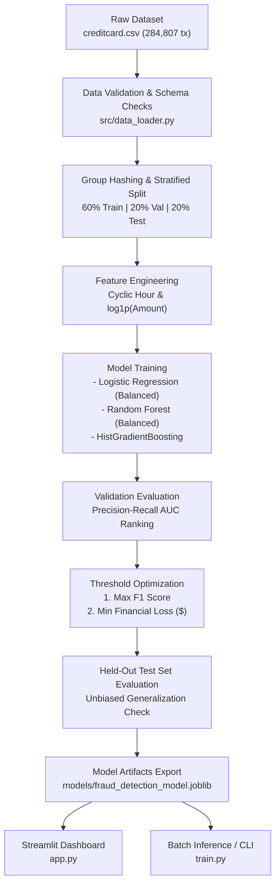

# 🛡️ CardGuard: End-to-End Credit Card Fraud Detection System

[](https://www.python.org/downloads/)
[](https://scikit-learn.org/)
[](https://streamlit.io/)
[](LICENSE)

> **Production-grade Machine Learning pipeline and interactive risk assessment dashboard for detecting fraudulent credit card transactions under extreme class imbalance.**

---

## 📌 Executive Summary & Business Challenge

Credit card fraud costs the global economy tens of billions of dollars annually. Building an automated fraud detection engine presents two major challenges:

1. **Extreme Class Imbalance:** In this dataset of 284,807 transactions, only **492 are fraudulent (0.172%)**. A naive model that classifies every transaction as legitimate achieves **99.83% accuracy**, yet fails to prevent a single dollar of fraud.
2. **Asymmetric Business Cost:** 
   - A **False Negative (Missed Fraud)** directly loses the stolen transaction balance, incurs chargeback fees, and damages customer trust ($\approx \$250+$ loss).
   - A **False Positive (False Alarm)** causes customer embarrassment, verification friction, and operational investigation overhead ($\approx \$10$ cost).

**CardGuard** solves this by formulating fraud detection not as a generic classification task, but as a **cost-sensitive risk ranking system** optimized for **Precision-Recall AUC (Average Precision)** and financial utility.

---

## 🚀 Key Technical Highlights

- **Leakage-Free Group-Aware Splitting:** Identical transaction feature vectors are detected using hash clustering and assigned to the same partition using `StratifiedGroupKFold`. This eliminates data leakage across Train (60%), Validation (20%), and Test (20%) splits.
- **Model Comparison Suite:** Evaluates linear baselines (`LogisticRegression`), ensemble methods (`RandomForest`), and modern gradient boosting (`HistGradientBoostingClassifier`).
- **Dual Threshold Optimization:**
  - **Statistical Optimization:** Maximizing validation $F_1$ score to balance precision and recall.
  - **Financial Loss Optimization:** Minimizing expected operational dollar loss:
    $$\text{Total Loss}(\theta) = C_{\text{FP}} \cdot \text{False Positives}(\theta) + C_{\text{FN}} \cdot \text{False Negatives}(\theta)$$
- **Interactive Streamlit Web Dashboard:**
  - ⚡ **1-Click Presets:** Instant evaluation of real-world scenarios (Everyday coffee, compromised account, zero-value card testing).
  - 🎯 **Visual Risk Gauge:** Real-time color-coded risk meter with decision confidence margin.
  - 📊 **Feature Anomaly Signal Inspector:** Explains which PCA components contributed most heavily to the anomaly signal.
  - 📁 **Batch File Scanner:** Bulk CSV processing with KPI summary cards and downloadable predictions.
  - 💰 **Live Bank Loss Simulator:** Adjust thresholds and operational costs in real-time to observe economic impact.
- **Production Architecture (`src/`):** Clean separation of concerns with unit tests in `tests/` and a standalone CLI entrypoint (`train.py`).

---

## 🏗️ System Architecture



---

## 📊 Benchmark Results

### 1. Validation Model Comparison (Default Threshold 0.50)

| Model | Accuracy | Precision | Recall | $F_1$ Score | ROC-AUC | PR-AUC (Average Precision) |
| :--- | :---: | :---: | :---: | :---: | :---: | :---: |
| **Random Forest (Balanced)** | **99.95%** | **88.41%** | 72.62% | **0.7974** | 0.9724 | **0.8069** |
| **Logistic Regression (Balanced)** | 97.76% | 5.58% | **89.29%** | 0.1051 | **0.9767** | 0.6814 |
| **Dummy Baseline (Majority Class)** | 99.85% | 0.00% | 0.00% | 0.0000 | 0.5000 | 0.0015 |

> **Key Takeaway:** While Logistic Regression achieved high recall (89.3%), its precision was only 5.6% (generating massive false alarms). Random Forest delivered high precision (88.4%) with strong recall, winning on PR-AUC.

### 2. Held-Out Test Evaluation at Tuned Thresholds

| Decision Setting | Threshold | Precision | Recall | $F_1$ Score | Fraud Caught | False Alarms | Missed Fraud |
| :--- | :---: | :---: | :---: | :---: | :---: | :---: | :---: |
| **Default Threshold** | 0.5000 | 95.70% | 78.07% | 0.8599 | 89 / 114 | 4 | 25 |
| **Tuned Max-$F_1$** | **0.4438** | **94.79%** | **79.82%** | **0.8667** | **91 / 114** | **5** | **23** |

*Tuning the threshold on validation data caught additional fraud cases while keeping false alarms exceptionally low (only 5 false alarms out of 56,848 legitimate test transactions).*

---

## 📂 Repository Structure

```text
credit-card-fraud-detection/
├── app.py                     # Streamlit web application
├── train.py                   # Standalone CLI training and evaluation script
├── requirements.txt           # Python dependencies
├── sample_transactions.csv    # Ready-to-use sample batch for testing
├── Credit_Card_Fraud_Detection.ipynb  # Exploratory research notebook
│
├── src/                       # Modular production package
│   ├── __init__.py
│   ├── data_loader.py         # Data loading, validation, group-aware splitting
│   ├── features.py            # Feature transformations (cyclic time, log amount)
│   ├── models.py              # Scikit-learn pipelines & artifact serialization
│   └── evaluate.py            # PR-AUC, metrics, and cost-benefit threshold tuning
│
├── tests/                     # Automated unit and integration test suite
│   ├── __init__.py
│   ├── test_data_loader.py
│   ├── test_features.py
│   ├── test_models.py
│   └── test_evaluate.py
│
├── data/                      # Dataset directory (gitignored)
│   └── creditcard.csv
│
└── models/                    # Saved model artifacts & benchmark tables
    ├── fraud_detection_model.joblib
    ├── validation_model_comparison.csv
    └── test_evaluation.csv
```

---

## 🛠️ Getting Started

### 1. Prerequisites & Environment Setup
Clone the repository and set up a Python virtual environment:

```bash
# Navigate to project directory
cd credit-card-fraud-detection

# Create and activate virtual environment
python3 -m venv .venv
source .venv/bin/activate  # On Windows: .venv\Scripts\activate

# Install dependencies
pip install -r requirements.txt
```

### 2. Download Dataset
Download `creditcard.csv` from [Kaggle: Credit Card Fraud Detection](https://www.kaggle.com/datasets/mlg-ulb/creditcardfraud) and place it inside the `data/` folder:
```bash
mkdir -p data
# Move your downloaded creditcard.csv into data/
```

### 3. Run Automated Tests
Execute the unit test suite to verify pipeline integrity:
```bash
pytest tests/ -v
```

### 4. Train the Model via CLI
Run the automated end-to-end training pipeline:
```bash
# Compare all models and tune thresholds
python train.py --model all

# Or run quick training on a specific model
python train.py --model hist_gradient_boosting
```

### 5. Launch the Streamlit Web Application
Start the interactive dashboard:
```bash
streamlit run app.py
```
Open your browser at `http://localhost:8501`.

---

## 💡 Web Application Walkthrough

| Feature | Description |
| :--- | :--- |
| **🔍 1-Click Presets** | Test the model immediately with pre-configured real scenarios (*Normal Coffee*, *Compromised Account*, *Card-Testing Fraud*). |
| **🎯 Risk Gauge & Confidence** | Visual meter displaying fraud probability and decision safety margin. |
| **🔍 Feature Anomaly Inspector** | Inspect deviations in key PCA components ($V14, V17, V12, V10$) against typical legitimate baselines. |
| **📁 Batch CSV Scanner** | Upload transaction batches, view fraud distributions, and download labeled CSVs. |
| **💰 Bank Loss Simulator** | Interactively adjust False Alarm and Missed Fraud costs to simulate operational financial impact. |

---

## 📈 Real-World Limitations & Next Steps

1. **Feature Anonymization:** In production banking systems, models utilize rich behavioral features (device fingerprint, IP velocity, card-present status, merchant category codes) rather than anonymized PCA components.
2. **Temporal Drift:** Financial fraud patterns mutate continuously. A production fraud engine requires daily drift monitoring and automated retraining pipelines.
3. **Graph Neural Networks (GNN):** Advanced fraud rings operate across interconnected mule accounts, making transaction-graph models an exciting future extension.

---

## 👤 Author & Acknowledgements

- **Author:** Sanjana
- **Dataset:** Machine Learning Group (ULB - Université Libre de Bruxelles) via Kaggle.
